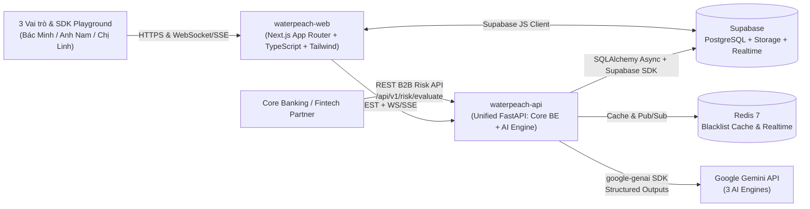

# waterpeach — Mạng lưới Bảo vệ Tài chính Gia đình & Future Workspace cho Đội ngũ Chống gian lận

> **Human Centered. AI Powered.**  
> *Giải pháp B2B2C Embedded SDK/API ("Cầu dao xã hội" — Social Circuit Breaker) tích hợp trực tiếp vào hệ sinh thái Ứng dụng Ngân hàng & Ví điện tử.*  
> **Dự thi:** MoMo Tech Contest — MoMo TechDay 2026

---

## 1. Tổng quan & Định vị Sản phẩm

Trong hệ sinh thái tài chính số tại Việt Nam, hệ thống AI phát hiện gian lận truyền thống đã làm rất tốt việc cảnh báo tự động. Tuy nhiên, **điểm mù nguy hiểm nhất** vẫn tồn tại ở nhóm nạn nhân bị **thao túng tâm lý (Social Engineering)** — nơi kẻ gian giả danh cơ quan công an, tòa án, điện lực hoặc shipper để cô lập tâm lý nạn nhân, khiến họ chủ động bỏ qua cảnh báo popup trên app để chuyển toàn bộ tiền tiết kiệm. Đồng thời, đội ngũ vận hành (**Fraud Ops**) phải xử lý hàng ngàn cảnh báo mỗi ngày trong tình trạng **mù ngữ cảnh xã hội**, thiếu thông tin xác thực từ người thân.

**waterpeach** giải quyết bài toán kép này bằng cách chuyển dịch từ mô hình *cảnh báo đơn lẻ* sang **"Cầu dao xã hội" (Social Circuit Breaker)**: kết nối hai chiều giữa **Vòng tròn Gia đình (Privacy-First)** và **Future Workspace của đội ngũ Fraud Ops**, dưới sự điều phối của 3 động cơ AI chuyên biệt.

### Giá trị thương mại cho Ngân hàng & Fintech (ROI)
- **Giảm 70–80% tỷ lệ cảnh báo giả (False Positives):** Xác nhận *"An toàn"* từ người thân giúp giải phóng giao dịch hợp lệ ngay lập tức, giảm tải chi phí nhân sự gọi điện xác minh.
- **Ngăn chặn thất thoát tiền & khiếu nại pháp lý:** Chặn đứng giao dịch lừa đảo ngay trong giai đoạn **hạ nhiệt (Cooling-off)** trước khi tiền bị tẩu tán qua các tài khoản rác.
- **Tăng độ gắn kết hệ sinh thái (Family Lock-in):** Khi con cái liên kết *Vòng tròn tin cậy* để bảo vệ bố mẹ trên cùng một nền tảng ngân hàng/ví điện tử, tỷ lệ giữ chân khách hàng (Retention) tăng mạnh cho cả hộ gia đình.
- **Tích hợp B2B2C không cần cài app mới:** Đóng gói dạng Embedded SDK/Widget + REST/Webhook API cho phép ngân hàng và siêu ứng dụng (MoMo, Techcombank, MB Bank...) nhúng trực tiếp vào luồng chuyển tiền sẵn có.

---

## 2. Đặc tả 3 Phân hệ Liên thông Thời gian thực

Hệ thống gồm **3 phân hệ** tương tác real-time qua WebSocket/SSE & Supabase Realtime, đại diện cho 3 vai trò người dùng:

### 2.1. Phân hệ 1: Embedded Banking UI — Thành viên được bảo vệ (VD: Bác Minh, 65 tuổi)
Giao diện mô phỏng ứng dụng Ngân hàng/Ví điện tử đã tích hợp **waterpeach SDK**:
- **Thiết lập Vòng tròn tin cậy (Trusted Circle):** Liên kết 1–3 người giám hộ; cài đặt ngưỡng bảo vệ linh hoạt (VD: chuyển cho người lạ trên 5.000.000 VNĐ, khung giờ nhạy cảm 22h–6h, hoặc tự động kích hoạt khi điểm rủi ro AI cao).
- **Cam kết Privacy-First:** Người giám hộ **KHÔNG** thấy số dư tài khoản và **KHÔNG** thấy lịch sử chi tiêu bình thường — chỉ nhận thông báo khi *"Cầu dao xã hội"* được kích hoạt.
- **Luồng Chuyển tiền có Cầu dao xã hội (Protected Transfer Flow):**
  - Rủi ro **Thấp**: Giao dịch đi qua bình thường, không gây cản trở trải nghiệm.
  - Rủi ro **Cao / Nghiêm trọng**: Giao dịch chuyển sang trạng thái **Tạm giữ hạ nhiệt (`cooling_off`)** trong 15–30 phút kèm đồng hồ đếm ngược và giải thích bằng ngôn ngữ bình dân, dễ hiểu.
- **Trợ lý Kiểm tra Lừa đảo Đa phương thức (Multimodal Scam Check):** Cho phép tải lên ảnh chụp màn hình tin nhắn Zalo/SMS, công văn/hóa đơn giả, hoặc đoạn text/audio cuộc gọi đáng ngờ để AI khoanh vùng dấu hiệu thao túng tâm lý và gửi cảnh báo nhanh cho cả nhà.

### 2.2. Phân hệ 2: Family Guardian Hub — Người giám hộ (VD: Anh Nam, con trai)
- **Cảnh báo Khẩn cấp Thời gian thực (Real-time Alert Card):** Hiển thị tối giản theo chuẩn Privacy-First (tên người thân, số tiền, tài khoản nhận, bản tóm tắt rủi ro do AI giải thích).
- **Quyền Quyết định 1-Chạm (Social Verification Actions):**
  - **Nút Đỏ — *"Nghi ngờ lừa đảo! Chặn & Báo Fintech"*:** Đóng băng giao dịch lập tức, nâng độ ưu tiên hồ sơ lên *Critical* tại Fraud Ops Workspace và gửi thông điệp trấn an tới người thân.
  - **Nút Xanh — *"An toàn, tôi đã xác nhận"*:** Mở khóa giao dịch ngay lập tức và gửi tín hiệu để AI tự động đóng cảnh báo giả phía Fintech.
  - **Nút Vàng — *"Cần gọi xác minh thêm"*:** Gia hạn tạm giữ thêm 30 phút và gợi ý câu hỏi kiểm tra nhanh không gây hoảng loạn.
- **Bảng tin An toàn Gia đình (Family Safety Feed):** Lưu lại các mẫu tin nhắn/cuộc gọi lừa đảo đã kiểm tra để cả gia đình cùng nâng cao cảnh giác.

### 2.3. Phân hệ 3: Fintech Fraud Ops Future Workspace — Đội ngũ Vận hành (VD: Chị Linh)
Trọng tâm thể hiện chủ đề *"Imagine the Future Workspace"*:
- **Hàng đợi Ưu tiên Thông minh (AI-Triaged Incident Queue):** Tự động phân hạng vụ việc dựa trên **Điểm rủi ro AI + Tín hiệu từ Gia đình** (case có người thân báo lừa đảo đẩy lên đầu; case người thân xác nhận an toàn chuyển vào *Auto-Resolved*).
- **AI Case Brief & Network Threat Intelligence:** Tổng hợp bức tranh vụ việc trong 5 giây (giao dịch, hành vi bất thường, bằng chứng đa phương thức, phản hồi giám hộ) và đối chiếu chéo số tài khoản/SĐT/URL trên mạng lưới liên gia đình.
- **AI De-escalation Copilot:** Sinh kịch bản gọi điện trấn an (Call Script) và tin nhắn hướng dẫn cá nhân hóa theo độ tuổi và kịch bản lừa đảo của nạn nhân.
- **Hành động 1-Chạm (1-Click Containment):** Phê duyệt hủy & hoàn tiền, đưa tài khoản nhận vào System-wide Blacklist (trích xuất IOCs), và xuất Incident Report tra soát liên ngân hàng.

---

## 3. Kiến trúc AI Cốt lõi (AI-Native Core — Google Gemini)

`waterpeach` vận hành dựa trên **3 động cơ AI** sử dụng **Google Gemini SDK (`google-genai`)** với **Structured Outputs (JSON)**:

1. **Động cơ 1 — Contextual Transaction Risk Engine (`/api/v1/ai/analyze-tx`):**
   - *Đầu vào:* Payload giao dịch (số tiền, tài khoản đích mới/cũ, thời gian, nội dung chuyển khoản) + Baseline profile + Threat Blacklist.
   - *Xử lý:* Phân tích ngữ nghĩa nội dung chuyển khoản (nhận diện cụm từ ẩn ý như *"nộp tạm giữ"*, *"chứng minh tài chính"*, *"làm nhiệm vụ"*, *"mở khóa tài khoản"*).
   - *Đầu ra:* `risk_score` (0–100), `risk_level` (`LOW` | `MEDIUM` | `HIGH` | `CRITICAL`), `scam_category`, `reasoning_for_victim`, `reasoning_for_guardian`.
2. **Động cơ 2 — Multimodal Scam Analyzer (`/api/v1/ai/analyze-scam`):**
   - *Đầu vào:* Hình ảnh chụp màn hình tin nhắn, văn bản giả mạo, hoặc text/audio hội thoại.
   - *Xử lý:* Phân tích thị giác & đa phương thức nhằm phát hiện bất thường văn bản giả mạo và 4 thủ thuật thao túng tâm lý (*Urgency, Authority, Fear, Greed*).
   - *Đầu ra:* Kết luận rủi ro, dấu hiệu thao túng cụ thể, và trích xuất thực thể nguy hiểm (`IOCs`: STK, SĐT, URL) nạp vào Threat Intelligence DB.
3. **Động cơ 3 — Agentic Fraud Ops Copilot (`/api/v1/ai/ops-copilot`):**
   - *Đầu vào:* Ngữ cảnh giao dịch + Phản hồi người giám hộ + Bằng chứng đa phương thức + Dữ liệu chéo trong DB.
   - *Xử lý & Đầu ra:* Tổng hợp Case Summary, đề xuất hành động xử lý kèm độ tự tin, và sinh Call Script hạ nhiệt tâm lý nạn nhân.

---

## 4. Kiến trúc Hệ thống Monorepo & Ngăn xếp Công nghệ

Phiên bản triển khai thực tế sử dụng mô hình **Monorepo gồm 2 server chính**, gộp **Core Backend Gateway** và **AI Engine Service** vào chung một máy chủ **FastAPI (`waterpeach-api`)**, kết hợp cùng **Supabase (Managed PostgreSQL + Storage/Realtime)** và **Redis**:

- **Lợi thế khi gộp BE + AI trên FastAPI:** Loại bỏ độ trễ network hop giữa tầng nghiệp vụ và tầng suy luận AI; đồng nhất hoàn toàn kiểu dữ liệu **Pydantic** giữa B2B Risk API (`/api/v1/risk/evaluate`), SQLAlchemy Async ORM, và Gemini Structured Outputs; đơn giản hóa triển khai Docker nhưng vẫn giữ ranh giới module rõ ràng (`app/api`, `app/services`, `app/ai`) để sẵn sàng tách worker/scale độc lập khi cần.



### Cấu trúc Thư mục Monorepo & Trách nhiệm Tầng Code

```text
waterpeach/
├── AGENTS.md                       # Quy chuẩn Harness Engineering (Git branching, separation of concerns, verify gate)
├── docs/
│   └── API_CONTRACT.md             # Đặc tả đầy đủ REST Endpoints, JSON Schemas, B2B Risk API & Realtime Events
├── waterpeach-web/                 # Frontend Server (Next.js App Router + TypeScript + Tailwind CSS + pnpm)
│   ├── src/
│   │   ├── app/                    # Next.js App Router pages & layouts
│   │   ├── components/
│   │   │   ├── victim/             # Phân hệ 1: Embedded Banking UI (Bác Minh)
│   │   │   ├── guardian/           # Phân hệ 2: Family Guardian Hub (Anh Nam)
│   │   │   ├── fraud-ops/          # Phân hệ 3: Fintech Fraud Ops Workspace (Chị Linh)
│   │   │   └── shared/             # Top Role Switcher, One-Click Scenarios, Reset Demo, B2B SDK Playground
│   │   ├── lib/                    # Typed API client, Supabase JS client, WebSocket/SSE hooks
│   │   └── types/                  # TypeScript interfaces (ánh xạ 1-1 với docs/API_CONTRACT.md)
│   ├── .env.example
│   ├── Dockerfile
│   └── package.json
│
├── waterpeach-api/                 # Unified Backend & AI Server (Python FastAPI + uv)
│   ├── alembic/                    # Database migrations lên Supabase (dùng DIRECT_URL port 5432)
│   ├── app/
│   │   ├── main.py                 # FastAPI entrypoint, CORS, routers & /health
│   │   ├── core/                   # Settings (pydantic-settings), xác thực B2B X-API-Key, logging
│   │   ├── db/                     # Kết nối Supabase PostgreSQL (AsyncSession), Supabase client & Redis
│   │   ├── models/                 # ORM Models (users, family_links, transactions, scam_reports, threat_blacklist)
│   │   ├── schemas/                # Pydantic v2 DTOs (Single Source of Truth cho API & Gemini Structured Outputs)
│   │   ├── api/v1/                 # Pure HTTP/WS Transport layer (không chứa SQL hay business logic)
│   │   ├── services/               # Nghiệp vụ (Transaction state machine, Trusted Circle, Blacklist cache)
│   │   └── ai/                     # 3 Động cơ AI (Contextual Risk, Multimodal Scam Analyzer, Ops Copilot)
│   ├── tests/                      # Unit & integration tests (pytest + httpx)
│   ├── .env.example
│   ├── Dockerfile
│   └── pyproject.toml
│
├── docker-compose.yml              # Khởi chạy Redis, API, Web (kèm profile local-db dự phòng)
├── .env.example                    # Biến môi trường mẫu (Supabase, Redis, Gemini)
├── .gitignore
└── README.md
```

### Thiết kế Cơ sở Dữ liệu Cốt lõi (Supabase PostgreSQL)
- **`users`**: `id`, `name`, `role` (`victim` | `guardian` | `fraud_ops`), `phone`, `account_number`, `bank_name`, `balance` (chỉ hiển thị cho `victim`, ẩn hoàn toàn khỏi `guardian`), `age_group`, `avatar`, `protection_threshold`, `sensitive_hours_enabled`.
- **`family_links`**: `id`, `victim_id`, `guardian_id`, `relationship`, `privacy_mode` (`alert_only`), `status`.
- **`transactions`**: `id`, `sender_id`, `recipient_name`, `recipient_account`, `recipient_bank`, `amount`, `transfer_note`, `status` (`completed` | `cooling_off` | `blocked` | `released`), `ai_risk_score`, `ai_analysis_json`, `guardian_decision` (`pending` | `flag_scam` | `approve_safe` | `hold_verify`), `ops_decision` (`pending` | `confirmed_fraud` | `false_positive`), `created_at`.
- **`scam_reports`**: `id`, `submitted_by`, `image_url`, `raw_text`, `ai_verdict`, `tactics_detected`, `extracted_entities_json` (SĐT, STK, URL), `shared_to_family`, `created_at`.
- **`threat_blacklist`**: `id`, `entity_type` (`bank_account` | `phone` | `url`), `entity_value`, `report_count`, `scam_pattern`, `status` (`suspected` | `confirmed_blacklisted`).

---

## 5. API Contract Tóm tắt

Chi tiết payload request/response, mã trạng thái và cấu trúc sự kiện real-time được đặc tả đầy đủ tại **[docs/API_CONTRACT.md](docs/API_CONTRACT.md)** (và tự động sinh tài liệu tương tác tại `/docs` khi chạy `waterpeach-api`).

| Nhóm Endpoint | Method & Path | Mục đích |
| :--- | :--- | :--- |
| **System** | `GET /health` | Readiness probe cho container & dịch vụ |
| **B2B Partner API** | `POST /api/v1/risk/evaluate` | Core Banking gửi giao dịch chấm điểm rủi ro (`X-API-Key`) |
| **Mobile Banking & Victim** | `GET /api/v1/users/{user_id}/profile` | Lấy số dư ví thật, hồ sơ Mobile Banking & lịch sử giao dịch |
| | `GET /api/v1/transactions/lookup-account` | Tra cứu tên người nhận & kiểm tra Blacklist theo thời gian thực |
| | `POST /api/v1/transactions/transfer` | Khởi tạo giao dịch chuyển tiền có Cầu dao xã hội |
| | `GET /api/v1/transactions/{tx_id}` | Theo dõi trạng thái & đồng hồ đếm ngược cooling-off |
| **Nhóm Gia đình (Trusted Circle)** | `GET /api/v1/family/trusted-circle` | Lấy danh sách thành viên nhóm gia đình & ngưỡng bảo vệ |
| | `POST /api/v1/family/members` | Thêm / mời thành viên giám hộ vào Nhóm Gia đình |
| | `DELETE /api/v1/family/members/{link_id}` | Gỡ thành viên khỏi Nhóm Gia đình |
| | `PUT /api/v1/family/settings` | Cấu hình hạn mức & khung giờ nhạy cảm |
| **Guardian Hub** | `GET /api/v1/guardian/alerts` | Danh sách cảnh báo tối giản chuẩn Privacy-First |
| | `POST /api/v1/guardian/transactions/{tx_id}/decision` | Quyết định 1-chạm (`flag_scam` / `approve_safe` / `hold_verify`) |
| | `GET /api/v1/family/safety-feed` | Bảng tin An toàn Gia đình |
| **Scam Check** | `POST /api/v1/scam-check/analyze` | Quét ảnh/text/audio lừa đảo đa phương thức & trích xuất IOCs |
| **Fraud Ops** | `GET /api/v1/ops/incidents` | Hàng đợi ưu tiên AI-Triaged Incident Queue |
| | `GET /api/v1/ops/incidents/{tx_id}/brief` | AI Case Brief + Network Intel + De-escalation Call Script |
| | `POST /api/v1/ops/incidents/{tx_id}/action` | 1-Click Containment (hoàn tiền, blacklist, xuất báo cáo) |
| | `GET` / `POST` / `api/v1/ops/blacklist` | Tra cứu & cập nhật danh sách đen hệ thống |
| **AI Engines** | `POST /api/v1/ai/analyze-tx`, `/analyze-scam`, `/ops-copilot` | Gọi trực tiếp 3 động cơ AI Gemini |
| **Demo & Realtime** | `POST /api/v1/demo/scenario/{1\|2\|3}`, `/demo/reset` | Kịch bản mẫu 1-chạm & reset dữ liệu sạch |
| | `WS /api/v1/ws/events` | Kênh đẩy sự kiện real-time giữa 3 vai trò |

---

## 6. Nguyên tắc Làm việc & Quy chuẩn Coding (Harness Engineering)

Đọc chi tiết tại **[AGENTS.md](AGENTS.md)**. Tóm tắt các quy tắc bắt buộc:
- **Chiến lược Git Branch:** `main` luôn ổn định (deployable). Mọi tính năng mới phải tách nhánh theo quy chuẩn `feat/<fe|be|ai>-<tên-ngắn>` hoặc `fix/<scope>-<vấn-đề>`, kèm commit theo chuẩn Conventional Commits (`feat(api): ...`, `feat(web): ...`).
- **Contract-First:** Mọi thay đổi API phải cập nhật đồng bộ `docs/API_CONTRACT.md`, `waterpeach-api/app/schemas/` (Pydantic v2) và `waterpeach-web/src/types/` (TypeScript strict).
- **Separation of Concerns:** Router trong `app/api/v1/` chỉ xử lý HTTP/WS transport; nghiệp vụ nằm ở `app/services/`; AI inference + fallback nằm ở `app/ai/`.
- **Verification Gate trước khi merge:**
  ```bash
  uv --directory waterpeach-api run ruff check .
  uv --directory waterpeach-api run pytest
  pnpm --dir waterpeach-web lint
  pnpm --dir waterpeach-web build
  ```

---

## 7. Trải nghiệm Mobile Banking Thực chiến & Zero-Friction Demo UX

Sản phẩm được thiết kế như một **ứng dụng Mobile Banking hoàn chỉnh** (chứ không chỉ là các nút bấm test rời rạc) để Ban Giám khảo trải nghiệm chân thực cách **waterpeach SDK** vận hành bên trong app Ngân hàng / Ví điện tử:
- **Mobile-in-Web Shell (cho Bác Minh & Anh Nam):** Hiển thị trong khung điện thoại trực quan với số dư ví thật, lịch sử giao dịch, thanh điều hướng và các tiện ích ngân hàng. Trong đó các tính năng cốt lõi (**Chuyển tiền**, **Tạo & quản lý Nhóm Gia đình**, **Kiểm tra Lừa đảo AI**, **Xác thực 1-chạm**) hoạt động **thật 100% end-to-end** với Supabase DB và Gemini AI; các tiện ích phụ trợ (nạp ĐT, hóa đơn...) đóng vai trò hoàn thiện trải nghiệm thị giác của app ngân hàng.
- **Desktop Future Workspace (cho Chị Linh - Fraud Ops):** Giao diện vận hành chuyên nghiệp toàn màn hình.
- **Top Role Switcher & Split-View Mode:** Chuyển đổi 1-chạm giữa 3 vai trò (*Bác Minh* — *Anh Nam* — *Chị Linh*), hỗ trợ **chế độ xem song song 2 điện thoại** (*Bác Minh* + *Anh Nam*) để quan sát thông báo real-time tức thì, kèm tab *B2B API & SDK Playground*.
- **Bộ Kịch bản Mẫu 1-Chạm (Quick-Fill & One-Click Scenarios):**
  1. *Kịch bản 1 (Lừa đảo mạo danh Công an):* Chuyển 25.000.000 VNĐ kèm nội dung *"Nop tien tam giu xac minh ho so"* → Cầu dao xã hội kích hoạt → Người giám hộ bấm Chặn → Fraud Ops nhận cảnh báo đỏ, sinh kịch bản gọi điện và đưa STK vào Blacklist.
  2. *Kịch bản 2 (Giao dịch hợp lệ — Giảm cảnh báo giả):* Chuyển 18.000.000 VNĐ cho cửa hàng xe máy → Tạm giữ → Người giám hộ bấm *"An toàn, đang ở cùng bố"* → Giải ngân tức thì, Fraud Ops tự động đóng case.
  3. *Kịch bản 3 (Quét ảnh tin nhắn lừa đảo):* Tải lên ảnh chụp màn hình tin nhắn giả mạo shipper/thuế → AI phân tích dấu hiệu thao túng → Trích xuất STK lạ vào Threat Intelligence DB.
- **Nút "Reset Demo Data":** Khôi phục số dư ví và dữ liệu sạch chỉ với 1 cú nhấp chuột.

---

## 8. Hướng dẫn Cài đặt & Khởi chạy

### Yêu cầu Tiên quyết
- **Tài khoản Supabase** (lấy `SUPABASE_URL`, `SUPABASE_ANON_KEY`, `SUPABASE_SERVICE_ROLE_KEY`, `DATABASE_URL` port `6543` và `DIRECT_URL` port `5432`)
- **Google Gemini API Key** (lấy tại Google AI Studio)
- **Docker & Docker Compose** (khuyên dùng) hoặc môi trường Local: **Node.js >= 20**, **pnpm**, **Python >= 3.12**, **uv**

### Cách 1: Chạy bằng Docker Compose (Khuyên dùng)

1. Tạo file `.env` từ file mẫu ở thư mục gốc và điền thông tin **Supabase** + **`GEMINI_API_KEY`**:
   ```bash
   cp .env.example .env
   ```
2. Khởi chạy hệ thống (`redis`, `waterpeach-api`, `waterpeach-web`):
   ```bash
   docker compose up --build
   ```
   *(Nếu muốn chạy PostgreSQL cục bộ thay vì Supabase Cloud, dùng profile: `docker compose --profile local-db up --build`)*
3. Truy cập các dịch vụ:
   - **Frontend Web App:** http://localhost:3000
   - **Backend & AI API (Swagger UI):** http://localhost:8000/docs
   - **Health Check:** http://localhost:8000/health

### Cách 2: Chạy môi trường Phát triển Local (Development)

#### 1. Khởi chạy Redis (Cache & Realtime Pub/Sub)
```bash
docker compose up -d redis
```

#### 2. Khởi chạy Unified Backend & AI (`waterpeach-api`)
```bash
cd waterpeach-api
cp .env.example .env
uv sync
uv run uvicorn app.main:app --reload --port 8000
```

#### 3. Khởi chạy Frontend (`waterpeach-web`)
```bash
cd waterpeach-web
cp .env.example .env.local
pnpm install
pnpm dev
```

---

## 9. Thư viện Mã nguồn Mở & Khai báo Minh bạch Công cụ AI

### Thư viện Mã nguồn Mở Chính
- **Frontend (`waterpeach-web`):** Next.js (MIT), React (MIT), TypeScript (Apache-2.0), Tailwind CSS (MIT), Lucide React (ISC), `@supabase/supabase-js` (MIT).
- **Backend & AI (`waterpeach-api`):** FastAPI (MIT), Uvicorn (BSD-3-Clause), Pydantic (MIT), SQLAlchemy (MIT), Alembic (MIT), asyncpg (Apache-2.0), redis-py (MIT), `supabase` (MIT), Google GenAI SDK `google-genai` (Apache-2.0).
- **Hạ tầng:** Supabase (PostgreSQL), Redis.

### Khai báo Minh bạch Công cụ AI Sử dụng
- **Nền tảng AI Lõi trong Sản phẩm:** Google Gemini API (Gemini Flash) thông qua SDK chính thức `google-genai` để thực hiện đánh giá rủi ro giao dịch theo ngữ cảnh, phân tích bằng chứng đa phương thức (hình ảnh/văn bản) và hỗ trợ điều tra/hạ nhiệt tâm lý (Ops Copilot).
- **Hỗ trợ Phát triển Phần mềm:** Dự án có sử dụng trợ lý lập trình AI (Antigravity / Gemini) trong quá trình khởi tạo cấu trúc monorepo, thiết kế tài liệu kỹ thuật và hỗ trợ phát triển mã nguồn; toàn bộ kiến trúc, quyết định nghiệp vụ và kiểm thử chất lượng đều do đội ngũ phát triển trực tiếp thiết kế và kiểm soát.

---
*Phiên bản tài liệu: `README.md v1` — Khởi tạo cho dự án **waterpeach** (MoMo TechDay 2026).*
